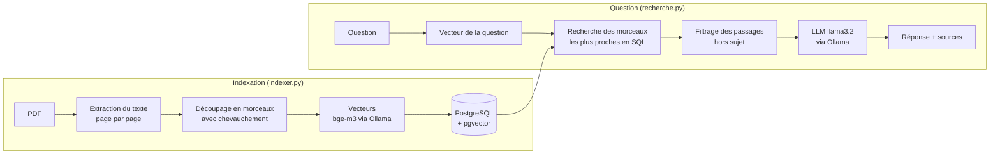

# RAG comptable – assistant documentaire auto-hébergé

Assistant qui répond à des questions sur des documents comptables (factures, notes internes) **en citant ses sources**.
Tout tourne **en local** : les documents, les vecteurs et les modèles d'IA restent sur la machine. Aucune donnée n'est envoyée à un service externe, ce qui est indispensable pour des données confidentielles comme celles d'un cabinet d'expertise comptable.

> Les documents du dossier `data/` sont **fictifs**.

## Exemple

```
Ta question : j'ai payé combien chez Formatix ?

0.652 | facture_2026-112.pdf (page 1)

===== RÉPONSE =====
Vous avez payé 1440,00 EUR chez Formatix Formation.
- Montant HT : 1200,00 EUR
- TVA (20 %) : 240,00 EUR
- Total TTC : 1440,00 EUR

Fichiers sources utilisés :
- facture_2026-112.pdf, page 1
```

## Fonctionnement



1. **Indexation** (une seule fois par document) : chaque PDF est lu page par page, découpé en morceaux, transformé en vecteurs, puis enregistré dans PostgreSQL avec son nom de fichier et son numéro de page.
2. **Question** : seule la question est vectorisée. PostgreSQL retrouve les morceaux les plus proches grâce à pgvector, puis le LLM rédige la réponse à partir de ces morceaux uniquement.

## Stack technique

| Brique | Choix |
|---|---|
| Langage | Python |
| Lecture des PDF | pypdf |
| Embeddings | `bge-m3` (1024 dimensions) via Ollama |
| LLM | `llama3.2` via Ollama |
| Base de données | PostgreSQL 16 + pgvector (index HNSW, similarité cosinus) |
| Conteneurisation | Docker |

## Choix techniques et problèmes rencontrés

**Découpage sans couper les mots.** Ma première version coupait le texte tous les N caractères, au milieu des mots. Je l'ai améliorée pour couper sur le dernier espace avant la limite (`rfind`) et faire démarrer le morceau suivant sur un mot entier (`find`), tout en gardant un chevauchement de 150 caractères pour ne pas perdre d'information à la frontière entre deux morceaux.

**Taille des morceaux.** Avec des morceaux de 200 caractères, le nom du fournisseur et le Total TTC d'une facture se retrouvaient dans deux morceaux différents : la recherche trouvait la bonne facture, mais pas le montant. Je suis passé à 1 000 caractères pour garder ces informations ensemble.

**Choix du modèle d'embedding.** J'ai comparé deux modèles sur des phrases en français. `nomic-embed-text` classait « Recette de la tarte aux pommes » devant « Montant de la facture à régler » pour la question « Combien dois-je payer ? », même avec ses préfixes recommandés. `bge-m3`, multilingue, a donné un classement cohérent (0,740 contre 0,381). Je l'ai donc retenu.

**PostgreSQL + pgvector plutôt qu'une base vectorielle dédiée.** Les morceaux, leurs métadonnées et leurs vecteurs sont dans une seule base, interrogée en SQL. Cela permettra aussi de combiner facilement recherche sémantique et recherche plein texte.

**Passages hors sujet.** Une note de frais sans rapport avec la question faisait se contredire le LLM. Je ne garde que les morceaux dont le score est proche du meilleur (écart de 0,05 maximum), et le prompt demande d'ignorer les extraits non pertinents.

**Erreurs de raisonnement du LLM.** La recherche trouvait la bonne facture, mais le LLM retirait parfois la TVA et répondait le montant HT. J'ai ajouté une règle métier dans le prompt (« le montant payé correspond au Total TTC ») et réglé la température à 0 pour des réponses plus stables.

## Installation

Prérequis : Python 3, Docker, [Ollama](https://ollama.com).

```bash
# 1. Modèles
ollama pull bge-m3
ollama pull llama3.2

# 2. Base de données
docker run -d --name rag-db \
  -e POSTGRES_USER=rag -e POSTGRES_PASSWORD=rag -e POSTGRES_DB=rag \
  -p 5432:5432 -v rag-data:/var/lib/postgresql/data \
  pgvector/pgvector:pg16
docker exec -i rag-db psql -U rag -d rag < schema.sql

# 3. Environnement Python
python3 -m venv .venv
source .venv/bin/activate
pip install -r requirements.txt

# 4. Indexer les documents, puis poser des questions
python3 indexer.py
python3 recherche.py
```

## Structure du projet

```
├── data/            Documents PDF fictifs
├── schema.sql       Structure de la base (table + index HNSW)
├── decoupage.py     Découpage du texte en morceaux
├── lire_pdf.py      Lecture des PDF et création des morceaux avec métadonnées
├── vecteur.py       Calcul des vecteurs et similarité cosinus
├── indexer.py       Enregistrement des morceaux et vecteurs dans PostgreSQL
└── recherche.py     Recherche des passages et génération de la réponse
```

## Prochaines étapes

- [ ] Recherche hybride : combiner recherche sémantique et recherche plein texte PostgreSQL
- [ ] Reranking des passages retrouvés
- [ ] API REST avec FastAPI (upload de documents, questions)
- [ ] Docker Compose pour lancer l'ensemble en une commande
- [ ] Jeu de questions de test pour évaluer la qualité des réponses

---

Projet développé avec l'assistance de Claude.